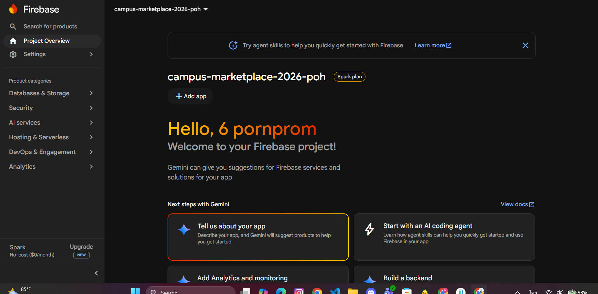

# บันทึกผลการทดลองสัปดาห์ที่ 9: Cloud Database — Firebase & Authentication
**ชื่อ-นามสกุล:** พรพรม สุขใจมิตร
**รหัสนักศึกษา:** 67030323

---

## ส่วนที่ 1: ตั้งค่า Firebase Project และเชื่อมกับ Flutter

### ✅ Checkpoint 1.1
**คำสั่ง:** ถ่ายภาพหน้าจอ Firebase Console ที่แสดงหน้า Project Overview ของโปรเจกต์ที่สร้างเสร็จแล้ว

> [!ภาพหน้าจอ Checkpoint 1.1]

---

## ส่วนที่ 2: Firebase Authentication ด้วย Email และ Password

### ✅ Checkpoint 2.1
**คำสั่ง:** 
1. ภาพหน้าจอ Firebase Console เมนู Authentication → Users ที่แสดงบัญชีที่เพิ่งสมัคร
2. ภาพหน้าจอข้อความ Error สมัครซ้ำด้วย Email เดิม
3. ภาพหน้าจอข้อความ Error ใส่รหัสผ่านสั้นเกินไป
4. อธิบายว่าโค้ดส่วนใดใน `auth_service.dart` เป็นตัวจัดการแต่ละกรณี

> [!ภาพหน้าจอ Checkpoint 2.1 - บัญชีใน Console]
> *(แทรกรูปภาพที่นี่)*

> [!ภาพหน้าจอ Checkpoint 2.1 - Error Email ซ้ำ]
> *(แทรกรูปภาพที่นี่)*

> [!ภาพหน้าจอ Checkpoint 2.1 - Error รหัสผ่านสั้น]
> *(แทรกรูปภาพที่นี่)*

**คำอธิบายโค้ดจัดการ Error:**
[พิมพ์คำอธิบายของคุณที่นี่ ว่าโค้ดส่วนไหน (try-catch, case ไหน) จัดการกับ 2 error นี้]

---

## ส่วนที่ 3: เข้าสู่ระบบด้วย Google Sign-In

### ✅ Checkpoint 3.1
**คำสั่ง:**
1. ภาพหน้าจอตอนเลือกบัญชี Google 
2. ภาพหน้าจอ Firebase Console ที่แสดงว่ามีผู้ใช้ใหม่ Provider เป็น Google เพิ่มเข้ามา
3. อธิบายว่า `idToken` กับ `accessToken` นำไปใช้ทำอะไรต่อ

> [!ภาพหน้าจอ Checkpoint 3.1 - เลือกบัญชี Google]
> *(แทรกรูปภาพที่นี่)*

> [!ภาพหน้าจอ Checkpoint 3.1 - Firebase Console User Google]
> *(แทรกรูปภาพที่นี่)*

**คำอธิบายการใช้งาน idToken และ accessToken:**
[พิมพ์คำอธิบายของคุณที่นี่]

---

## ส่วนที่ 4: AuthGate — สลับหน้าจอตามสถานะผู้ใช้

### ✅ Checkpoint 4.1
**คำสั่ง:** 
1. ภาพหน้าจอแอปตอนเปิดครั้งแรก (ยังไม่ล็อกอิน)
2. ภาพหน้าจอหลังล็อกอินสำเร็จ (สลับมา MainScaffold อัตโนมัติ)
3. ภาพหน้าจอหลังกดออกจากระบบ (สลับกลับมา Login อัตโนมัติ)
4. อธิบายว่าทำไม `StreamBuilder` จึงทำให้ไม่ต้องเขียนโค้ด Navigate ไปมา

> [!ภาพหน้าจอ Checkpoint 4.1 - หน้าแรกก่อน Login]
> *(แทรกรูปภาพที่นี่)*

> [!ภาพหน้าจอ Checkpoint 4.1 - หน้า MainScaffold หลัง Login]
> *(แทรกรูปภาพที่นี่)*

> [!ภาพหน้าจอ Checkpoint 4.1 - หน้า Login หลัง Logout]
> *(แทรกรูปภาพที่นี่)*

**คำอธิบายการทำงานของ StreamBuilder:**
[พิมพ์คำอธิบายของคุณที่นี่]

---

## ส่วนที่ 5: ขยาย Repository Pattern ด้วย ItemRepositoryFirestore

### 🧠 คำถามก่อนเขียนโค้ด (ขั้นตอนที่ 5.1)
**1. ทำไมเราจึง "เพิ่ม Implementation ใหม่" แทนที่จะแก้ไขของเดิม?**
[ตอบคำถามที่นี่]

**2. ถ้าอนาคตเปลี่ยน API ต้องแก้กี่ไฟล์?**
[ตอบคำถามที่นี่]

### ✅ Checkpoint 5.1
**คำสั่ง:** 
1. ภาพหน้าจอ Home ที่แสดงสินค้าจากทั้ง API และ Firestore ปนกัน พร้อม Badge
2. อธิบายข้อดีของการออกแบบให้ `HomePage` รู้จักแค่ Interface `ItemRepository`

> [!ภาพหน้าจอ Checkpoint 5.1 - หน้า Home แบบรวมข้อมูล]
> *(แทรกรูปภาพที่นี่)*

**คำอธิบายการออกแบบผ่าน Interface:**
[พิมพ์คำอธิบายของคุณที่นี่]

---

## ส่วนที่ 6: "โพสต์ขายจริง" — เชื่อม MyDraftsPage เข้ากับ Storage และ Firestore

### ✅ Checkpoint 6.1
**คำสั่ง:**
1. ภาพหน้าจอ Firebase Console (Firestore -> items) ที่มีเอกสารจริงและมี `sellerId`
2. ยืนยันว่าร่างรายการนั้นหายไปจาก MyDraftsPage

> [!ภาพหน้าจอ Checkpoint 6.1 - Firestore Documents]
> *(แทรกรูปภาพที่นี่)*

> [!ภาพหน้าจอ Checkpoint 6.1 - หน้า MyDraftsPage ที่ร่างหายไปแล้ว]
> *(แทรกรูปภาพที่นี่)*

### ✅ Checkpoint 6.2
**คำสั่ง:**
1. ภาพหน้าจอ Firebase Console (Storage) โชว์ไฟล์รูปภาพที่อัปโหลด
2. ภาพหน้าจอ Firestore โชว์ฟิลด์ `imageUrl`
3. ภาพหน้าจอแอปแสดงรูปนั้นบนหน้า Home 

> [!ภาพหน้าจอ Checkpoint 6.2 - Firebase Storage]
> *(แทรกรูปภาพที่นี่)*

> [!ภาพหน้าจอ Checkpoint 6.2 - Firestore imageUrl field]
> *(แทรกรูปภาพที่นี่)*

> [!ภาพหน้าจอ Checkpoint 6.2 - หน้า Home ที่โหลดรูปสำเร็จ]
> *(แทรกรูปภาพที่นี่)*

---

## ส่วนที่ 7: สำรวจ Firebase Security Rules (Self-Study)

### ✅ Checkpoint 7.1
**คำสั่ง:**
1. ภาพหน้าจอ Rules Playground กรณีผู้ใช้แก้ไขของตัวเอง (ผ่าน)
2. ภาพหน้าจอ Rules Playground กรณีผู้ใช้แก้ไขของคนอื่น (ถูกปฏิเสธ)
3. อธิบายว่าทำไม Client-side Validation อย่างเดียวจึงไม่ปลอดภัยพอ

> [!ภาพหน้าจอ Checkpoint 7.1 - Rules Playground (ผ่าน)]
> *(แทรกรูปภาพที่นี่)*

> [!ภาพหน้าจอ Checkpoint 7.1 - Rules Playground (ไม่ผ่าน)]
> *(แทรกรูปภาพที่นี่)*

**คำอธิบาย Client-side vs Server-side Security:**
[พิมพ์คำอธิบายของคุณที่นี่]

---

## ส่วนที่ 8: ทดสอบสถานการณ์ Offline และสถานะการล็อกอิน

### ✅ Checkpoint 8.1
**คำสั่ง:** ถ่ายภาพหน้าจอ 4 กรณี (เปิดใหม่ตอนล็อกอินค้าง, ปิดเน็ตดูรายการโปรด/ร่าง, ปิดเน็ตโพสต์ขาย, เปิดเน็ตโพสต์ขาย)

> [!ภาพหน้าจอ Checkpoint 8.1 - เปิดแอปใหม่โดยเข้าหน้า Home เลย]
> *(แทรกรูปภาพที่นี่)*

> [!ภาพหน้าจอ Checkpoint 8.1 - ปิดเน็ตดูรายการโปรด และ ร่าง]
> *(แทรกรูปภาพที่นี่)*

> [!ภาพหน้าจอ Checkpoint 8.1 - ปิดเน็ตลองกดโพสต์ขาย (แสดง Error)]
> *(แทรกรูปภาพที่นี่)*

> [!ภาพหน้าจอ Checkpoint 8.1 - เปิดเน็ตกลับมา แล้วโพสต์ขายสำเร็จ]
> *(แทรกรูปภาพที่นี่)*